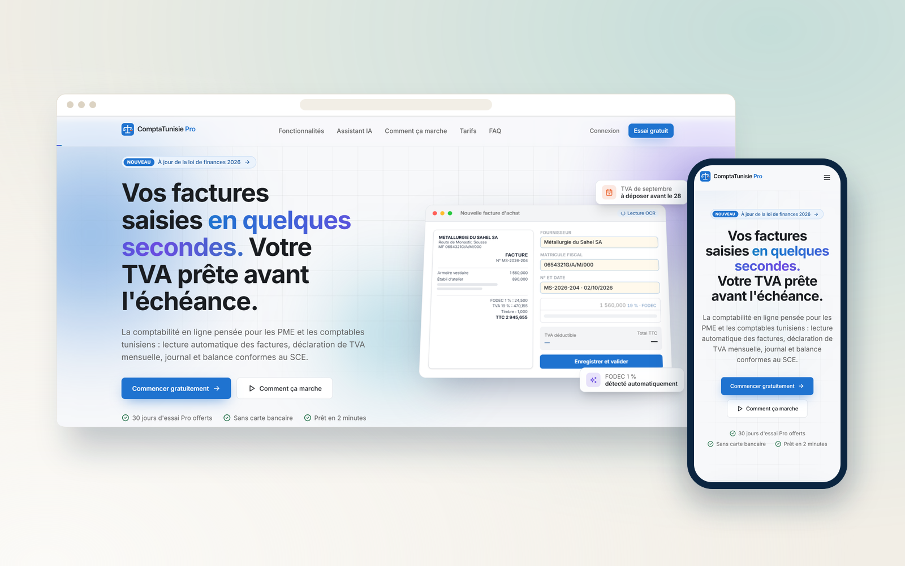
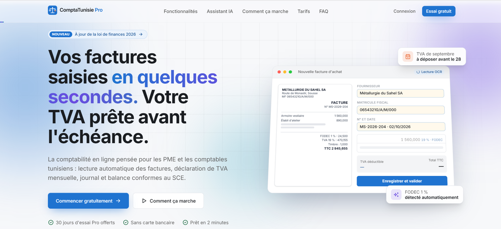
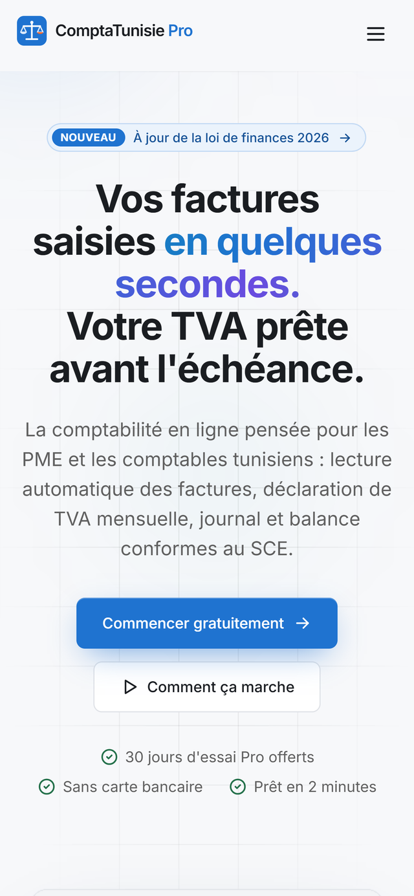
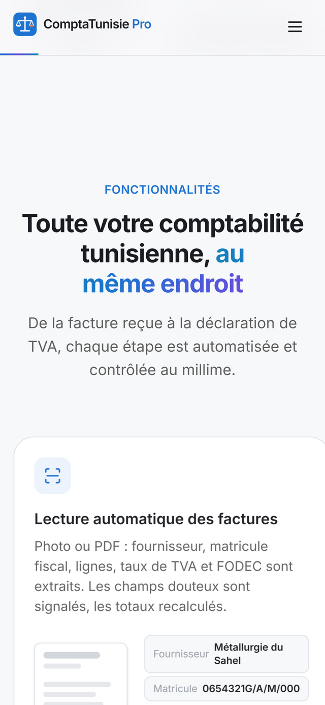
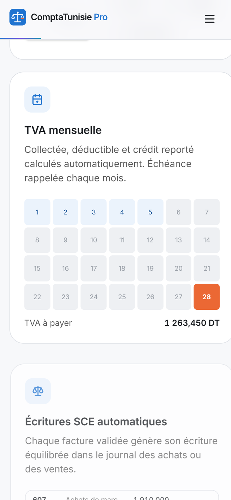

  

<h1 align="center">ComptaTunisie Pro</h1>

  <b>SaaS de comptabilité pour PME et cabinets tunisiens : OCR des factures, TVA et déclarations.</b>
   
  Accounting SaaS for Tunisian SMEs and firms: invoice OCR, VAT and tax filings.

  
  

  
  
  
  
  

---

## Le projet

Une application de comptabilité en ligne pensée pour le contexte tunisien. Les factures sont saisies automatiquement par OCR, la TVA mensuelle est calculée au millime près, et le journal comme la balance suivent le plan comptable SCE. L'intégrité des données est garantie par la base elle-même : chaque entreprise est isolée, une facture validée ne peut plus être modifiée et une période déclarée est verrouillée.

## Fonctionnalités

- Saisie des factures par OCR (PDF et photos), avec contrôle des montants côté serveur
- Calcul de la TVA mensuelle et préparation des déclarations (TVA, DETT)
- Journal et balance selon le plan comptable SCE, export CSV
- Moteur fiscal testé : TVA, FODEC, timbre, IRPP, IS et échéances
- Isolation multi-entreprise par RLS et journal d’audit automatique

## Aperçu

### Ordinateur

### Mobile

  
  
  

## Fiche

| | |
|---|---|
| **Type** | Système sur mesure |
| **Contexte** | Produit SaaS |
| **Année** | 2026 |
| **Rôle** | Conception et développement complets (design, front-end, back-end, mise en ligne) |
| **Technologies** | Next.js · TypeScript · Supabase · OpenAI · Vitest |
| **Site** | [compta-tunisie-pro.vercel.app](https://compta-tunisie-pro.vercel.app) |

## Code source

> [!NOTE]
> Le code source de ce produit est privé. Ce dépôt est une vitrine : il présente le projet, ses fonctionnalités et des captures.
> Pour en discuter ou pour un projet similaire : [portfolio](https://satouri-dev.vercel.app/fr) · [LinkedIn](https://www.linkedin.com/in/abdel-monaam-satouri-054268314).

---

  Conçu et développé par <a href="https://satouri-dev.vercel.app/fr">Satouri Développement</a> · Djerba, Tunisie
   
  © 2026 Abdelmonaam Satouri — Tous droits réservés

